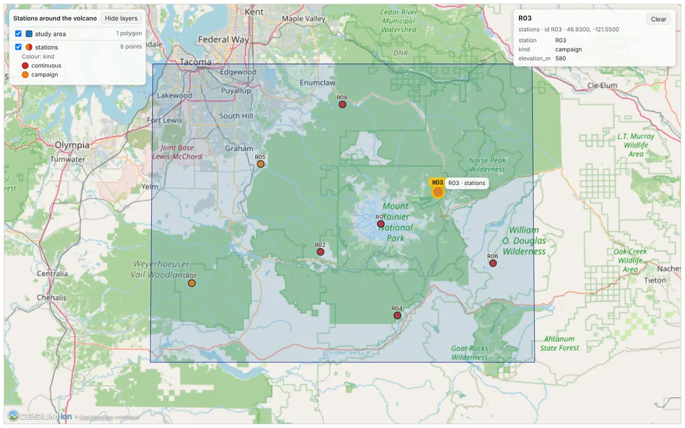

# Geo MCP

Install the launcher using the [CLIO Kit setup guide](../../setup.md) before
using the commands below. See [agent integrations](../../README.md#agent-integrations)
for MCP and skill configuration.

Renders GeoJSON vector layers into map images, or shows the same layers on an
interactive 3D globe. Any tool that returns GeoJSON features — catalog feature
queries, file inspection, analysis output — can be visualized as a single
layered map with an optional web-tile basemap.

## Tool: `render_feature_map`

Render one or more layers (polygons, lines, points) to a PNG.

Each layer:

```jsonc
{
  "name": "fire perimeter",
  "geojson": { /* FeatureCollection | Feature | geometry | list | JSON string | path */ },
  "style": {
    "facecolor": "red", "edgecolor": "darkred", "alpha": 0.55, "linewidth": 2,
    "color": "...",            // points / single-color fill
    "markersize": 45,          // points
    "zorder": 5,               // draw order
    "color_by": "AQI",         // property to color by
    "scale": "epa_aqi",        // EPA AQI bands, or a matplotlib colormap name
    "category_colors": { "3 - 25": "#ccc" },  // explicit value -> color
    "legend": true
  }
}
```

Top-level args: `output_path`, `title`, `basemap` (CartoDB Positron, needs
network; degrades gracefully if tiles are unavailable), and an optional
`bbox` view window `[min_lon, min_lat, max_lon, max_lat]`.

Returns `{status, output_path, size_bytes, bounds, basemap, layers}`.

### Example — wildfire downwind brief

Three layers from live feature queries: a fire perimeter polygon (red), NWS
smoke-forecast polygons colored by concentration class, and AirNow monitors
colored by `epa_aqi`. One call produces the full situational map.

## Tool: `show_on_globe`

Show the same layers on an interactive 3D globe (an
[MCP Apps](https://github.com/modelcontextprotocol/ext-apps) view, `ui://geo/globe`)
that the person can turn, zoom and click. Stations, regions, footprints and
tracks are drawn from the layer schema above, with the same styles: fixed
colours, `color_by` with `category_colors`, `epa_aqi` or a matplotlib colormap,
and a legend.



```jsonc
{
  "layers": [
    { "name": "stations", "geojson": "stations.geojson", "id_property": "station",
      "style": { "color_by": "kind", "category_colors": { "continuous": "#d62728" } } },
    { "name": "study area", "geojson": { "type": "Polygon", "coordinates": [ ... ] } }
  ],
  "files": ["footprints.geojson"],  // one layer per file, named after it
  "bbox": [-122.6, 46.5, -121.2, 47.25],  // or camera: {lon, lat, height_m}
  "title": "Stations around the volcano"
}
```

- **Lean result.** The agent reads layer names, feature counts, geometry,
  where each feature's id came from, colouring and bounds. The GeoJSON goes to
  the view only (`structuredContent`), never into the model's context.
- **The view.** CesiumJS 1.123 from Cesium's CDN with OpenStreetMap raster
  tiles and their attribution, and no Cesium ion token. Every point is a dot,
  labelled when a layer has 40 points or fewer (`style.label` names the
  property, `style.labels` forces labels on or off). A layer list toggles
  layers and shows each legend. Hovering a feature names it; clicking it
  highlights it and lists its properties. The view shows the layers'
  bounds when it opens (placed at once, so a frame not yet on screen opens in
  the right place). Labels of close points appear once the camera is near enough
  to tell them apart. Its panels follow the host's light or dark theme and
  style variables.
- **Linked selection.** Every feature has a stable string id: the
  `id_property` value, else the feature's `id`, else `properties.id`, else
  `<layer>-<n>`. The view reports `selected_feature` (that id), `selection`
  (layer, name, properties, position), `camera` and `layers` with
  `ui/update-model-context`, so the agent knows what the person picked.
  `selected_feature` is also a setter (`select_feature`): a host that sets it,
  for example from a linked table row, turns the globe to that feature (coming
  near enough to tell it from its neighbours) and highlights it, in one step
  when the person prefers reduced motion. The tool
  declares these state keys in `_meta["ai.iowarp.clio/state"]`.
- **App tools.** The view offers `fly_to` (`bbox` or `point`), `select_feature`,
  `add_layer`, `remove_layer`, `set_style` and `get_view` (camera, area in view
  and the selected feature).
- **Saved views.** Each call saves its view under a view id (`g` and ten hex
  digits) in clio-kit's data folder (`GEO_MCP_GLOBE_DIR` overrides it). A layer
  read from a file is saved as its path and read again on reopen; inline
  GeoJSON is saved as given. `show_on_globe(view="g…")` shows the saved layers
  again, which is also what the result declares a host should replay
  (`_meta["ai.iowarp.clio/reopen"]`, with the title). `title` is the tool's
  first argument, so a host that names a view by its first short text
  argument reads the title rather than a view id. Layer edits from the view go through
  `edit_globe_view`, a tool only the view calls, so a reopen shows them.
  `files` is declared as a local read path (`_meta["ai.iowarp.clio/paths"]`).
- **Refusals.** A missing file, malformed JSON, a style that is not a colour or
  colormap, a declared `id_property` some features lack, repeated layer names
  and more than 24 MB of GeoJSON are refused with the reason. Features with no
  or malformed geometry are skipped and counted in the result. A reopened view
  whose file is gone shows its other layers and names the missing one.

The view's host needs network access to `cesium.com` and
`tile.openstreetmap.org`; both are declared in the resource's
`_meta.ui.csp`. Loading CesiumJS and the OpenStreetMap imagery follows the MCP
Apps map example (`examples/map-server`, MIT).

## Run

```sh
clio-kit mcp-server geo          # via the clio-kit launcher
geo-mcp                   # direct entry point
```

## Test

```sh
uv run --frozen pytest
```

Tests disable the basemap so they run without network access.

The globe view has a browser check in a stand-in MCP Apps host (headless
Chromium, software WebGL). It draws a station layer and a polygon layer,
clicks a dot, sets `selected_feature` from the host, flies, adds, restyles and
removes a layer, and switches to the dark theme. It needs node with Playwright
and network access to `cesium.com` and `tile.openstreetmap.org`:

```sh
GEO_GLOBE_BROWSER=1 uv run --frozen pytest tests/test_globe_tool.py -k stand_in
uv run --frozen python tests/browser/run_standin.py --out /tmp/geo-globe [--width 390 --height 844]
```

## Capabilities

### `render_feature_map`
**Description**: Render one or more GeoJSON layers (polygons/lines/points) onto a single map PNG with an optional basemap. Each layer accepts a style with fixed colors or data-driven coloring (color_by + category_colors, an 'epa_aqi' AQI scale, or a matplotlib colormap). Returns the output path and bounds.
**Hints**: destructive, idempotent
**Tags**: geojson, geospatial, map, visualization

### `points_in_polygons`
**Description**: Spatial overlap: return which GeoJSON points fall within (optionally buffered) GeoJSON polygons — e.g. which AirNow monitors lie inside the smoke footprint. Accepts inline GeoJSON or file paths. Returns the matched points with their properties and a matched_count.
**Hints**: read-only, idempotent
**Tags**: geojson, geospatial, overlap, spatial-join

### `bounding_box`
**Description**: Compute the bounding box [min_lon, min_lat, max_lon, max_lat] of the VALID geometry in GeoJSON features (inline or file path), optionally padded by pad_km and rounded to 4 decimal places. Features whose geometry cannot be parsed are skipped, so feature_count reports valid geometries only. Use this to derive an analysis region for mapping or a spatial query; use feature_bbox instead to measure a document's raw coordinate extent including malformed features.
**Hints**: read-only, idempotent
**Tags**: bbox, geojson, geospatial, region

### `query_arcgis_features`
**Description**: Query an ArcGIS FeatureServer layer (with optional lon/lat bbox and where clause) and write the returned features to a local GeoJSON file. The saved FeatureCollection can be fed directly into render_feature_map, points_in_polygons, or bounding_box.
**Hints**: read-only, idempotent
**Tags**: arcgis, features, geojson, geospatial, retrieval

### `geocode`
**Description**: Look up a free-text place name or location and return real coordinates from OpenStreetMap Nominatim (a lookup, not a model guess). Each match carries lat/lon, a [min_lon, min_lat, max_lon, max_lat] bbox, type, importance, and a provenance source so the region can be grounded and cited.
**Hints**: read-only, idempotent
**Tags**: coordinates, geocoding, location

### `filter_points_by_radius`
**Description**: Filter/rank any table of points by great-circle distance to a center. Reads a CSV (or GeoJSON points) of locations, computes the haversine distance from (center_lat, center_lon) to each row, and returns the rows within radius_km sorted ascending by distance, each annotated with distance_km. Latitude/longitude columns are auto-detected from common names (latitude/lat, longitude/lon/long) when not given. Domain-neutral: works for sensors, sites, cities, samples, or any lon/lat table.
**Hints**: read-only, idempotent
**Tags**: distance, filter, geospatial, haversine, proximity

### `inspect_geojson`
**Description**: Inspect a GeoJSON document and report its geometry types and counts, feature count, property keys (schema), bounding box [min_lon, min_lat, max_lon, max_lat], CRS if present, and total vertex count. Reads the document as written, without a geometry engine, so it reports what the file actually contains. Accepts a file path or inline GeoJSON.
**Hints**: read-only, idempotent
**Tags**: geojson, inspection, metadata, schema

### `validate_geojson`
**Description**: Validate the structural well-formedness of a GeoJSON document: that the top-level type is recognized and every geometry's type and coordinates are well-formed (correct nesting depth, finite numeric positions). Returns {valid, errors}. Run this before a rendering or overlap tool, which silently skip geometry they cannot parse.
**Hints**: read-only, idempotent
**Tags**: geojson, linting, validation

### `summarize_geojson`
**Description**: Produce a compact human-readable summary of a GeoJSON document: counts per geometry type, bounding box, property keys, and a few sample feature property sets. Accepts a file path or inline GeoJSON.
**Hints**: read-only, idempotent
**Tags**: geojson, inspection, summary

### `feature_bbox`
**Description**: Compute the bounding box [min_lon, min_lat, max_lon, max_lat] of EVERY coordinate in a GeoJSON document, without validating geometry and without rounding. feature_count counts all features in the document, including malformed ones. Use this to inspect a file's raw extent; use bounding_box instead for the extent of valid geometry, padded and rounded, when feeding a map render or spatial query.
**Hints**: read-only, idempotent
**Tags**: bbox, geojson, inspection

### `show_on_globe`
**Description**: Show GeoJSON layers (points, lines, polygons: stations, regions, footprints, tracks) on an interactive 3D globe the person can turn, zoom and click. Takes render_feature_map's layer schema and styles (color_by, category_colors, legend). For GeoJSON already in a file, pass its path in files. Returns layer names, feature counts and bounds, and a view id that shows the same layers again. The person's clicked feature is reported back as selected_feature.
**Hints**: read-only
**Tags**: geojson, geospatial, globe, map, visualization

### `edit_globe_view`
**Description**: Add, remove or restyle one layer of a saved globe view. Called by the globe view itself when the person or the agent changes its layers.
**Hints**: read-only, idempotent
**Tags**: geospatial, globe

### Resources

- `ui://geo/globe` - An interactive CesiumJS globe showing the layers of show_on_globe.
- `geo://capabilities` - Describe what the geo MCP server can do.

### Prompts

- **map_arcgis_layer**: Guided workflow: retrieve an ArcGIS layer and render it on a map.
## Claude Code

```bash
claude mcp add clio-geo -- clio-kit mcp-server geo
```

Or install via the CLIO Kit plugin marketplace:

```
/plugin marketplace add iowarp/clio-kit
/plugin install clio-geo@clio-kit
```
## Claude Desktop

Add to your Claude Desktop config (`claude_desktop_config.json`):

```json
{
  "mcpServers": {
    "clio-geo": {
      "command": "clio-kit",
      "args": [
        "mcp-server",
        "geo"
      ]
    }
  }
}
```